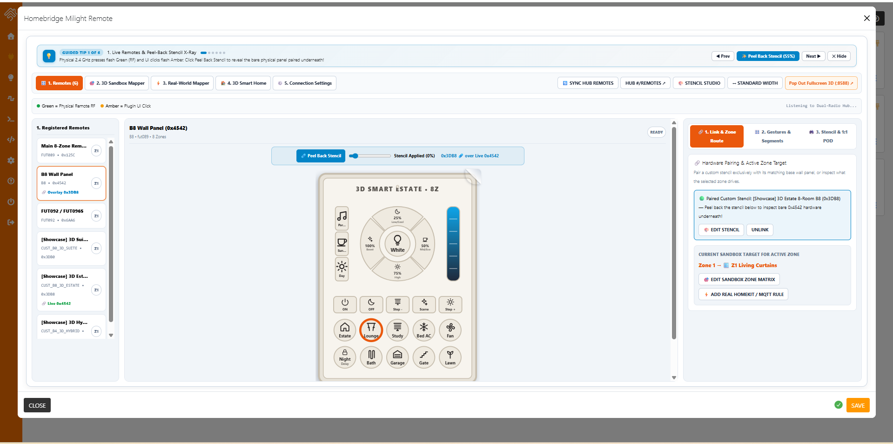
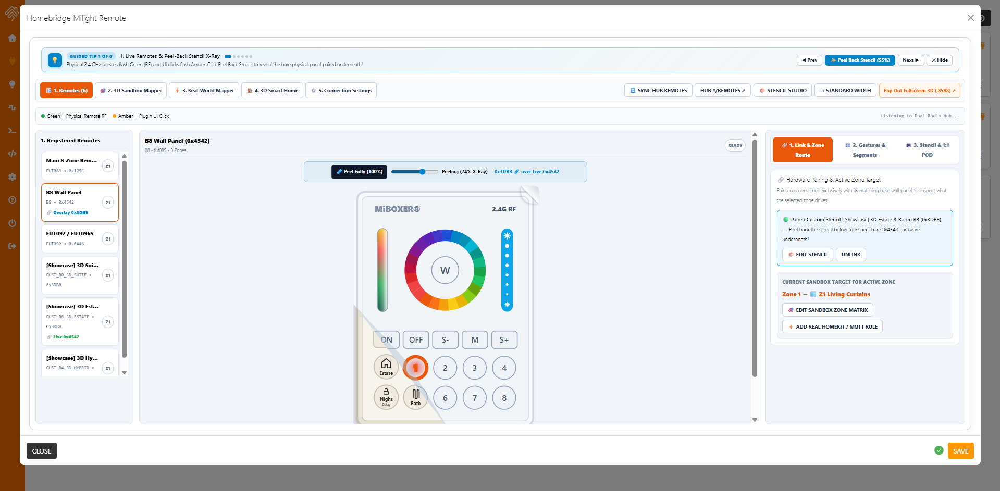
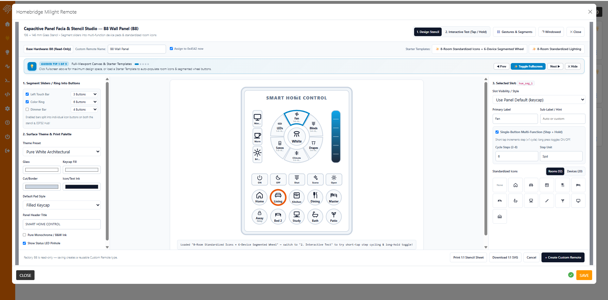
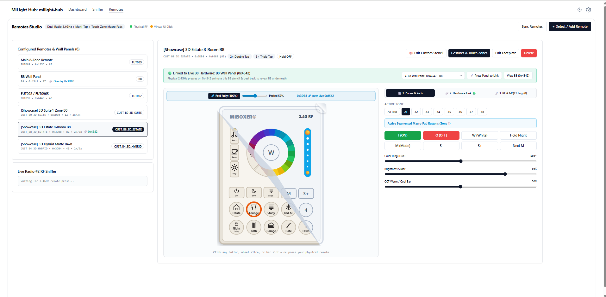
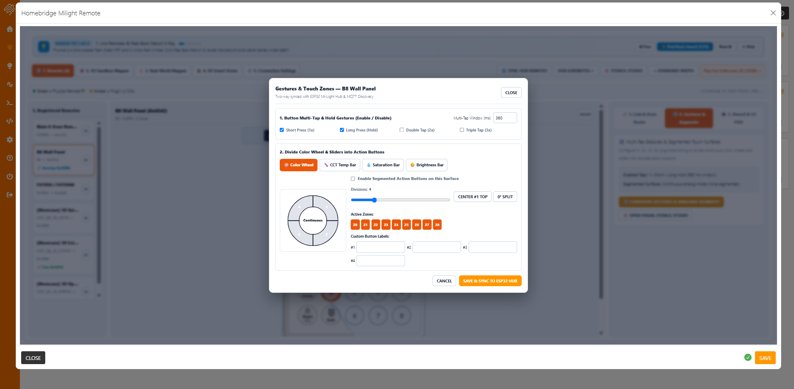
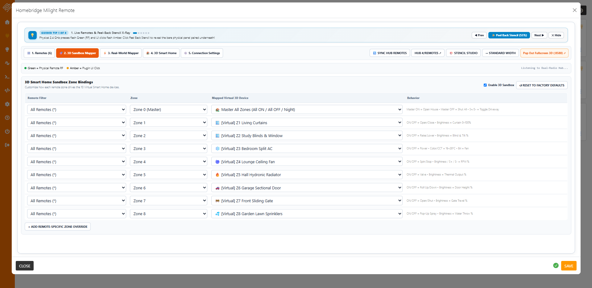
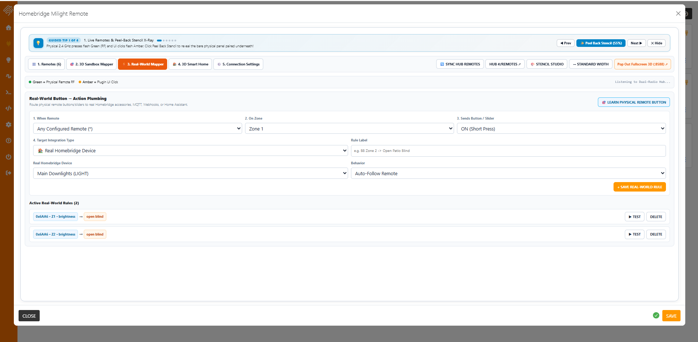
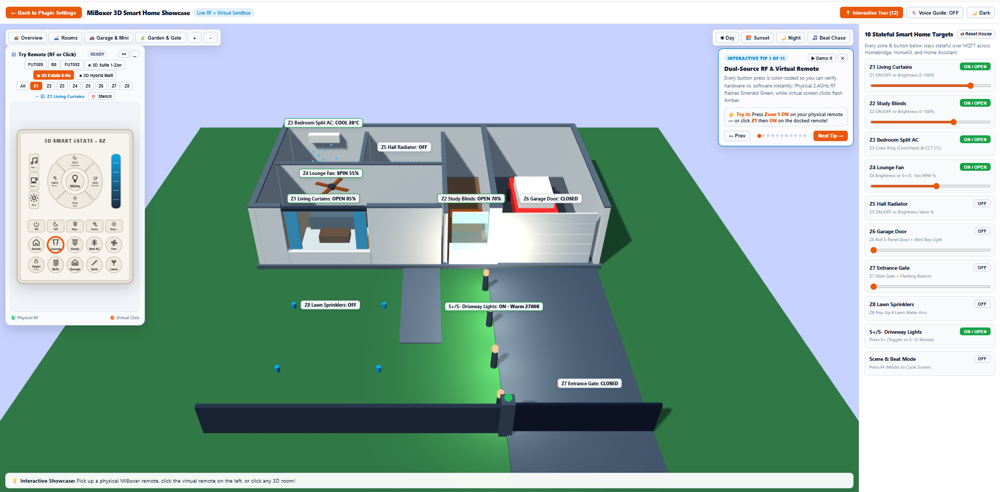
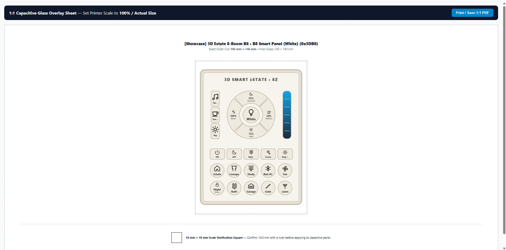

# homebridge-milight-remote

<!-- VISUAL_SHOWCASE_START -->
## Visual Walkthrough & Feature Guide

### 1. Bounded `96vw` Hero Cockpit & Strict Base-Shell Hardware Pairing

* **Single-Frame 3-Column Studio:** Tailored for Homebridge Config UI X with zero vertical scroll sprawl — **Registered Remotes** on the left, the full-scale **Hero Capacitive Wall Panel** in the center, and focused **Link / Gestures / 1:1 POD** sub-tabs on the right, topped by an interactive **6-Step Guided Showcase Tour**.
* **Strict Hardware Shell Compatibility:** Custom stencils (`0x3DB8` 8-Room Estate B8) pair exclusively with compatible physical shells (`0x4542` B8 Wall Panel) so real 2.4 GHz touches animate your custom room/appliance pads directly.

### 2. Real-Time Diagonal Peel-Back Stencil X-Ray (`74%` Peel View)

* **Verify Underlying Factory Glass Alignment:** Drag **Peel Back Stencil** (shown here peeled to `74%`) to curl back your custom vinyl overlay diagonally and inspect the bare MiBoxer RGB+CCT touch wheel, brightness bar, and zone buttons underneath while keeping **🟢 Physical RF** and **🟠 Virtual UI** reticles synchronized.

### 3. Fullscreen Capacitive Stencil Studio & ESP32 Hub Native `#/remotes` Sync
| Fullscreen Capacitive Stencil Designer | ESP32 Hub Native `#/remotes` (`52%` Peel-Back) |
| :---: | :---: |
|  |  |
| Split continuous wheels & touch bars into discrete macro keycaps with **Single-Button Step-Cycling (`1→6`) + Long-Hold Toggle**, 32 architectural icons, and extension-safe `1:1` SVG / POD JSON export. | Shares the exact same `miboxer_catalog.js` and `remote_studio.js` engine embedded in the ESP32 Dual-Radio Hub firmware (`PROGMEM`), keeping custom models & pairings in sync everywhere. |

### 4. Multi-Tap Wheel Segmentation, 3D Sandbox Matrix & Real-World HomeKit Mapper
| Multi-Tap & Wheel Splitter | Tab 2 — 10-Device 3D Sandbox Matrix | Tab 3 — Real-World HomeKit / MQTT Mapper |
| :---: | :---: | :---: |
|  |  |  |
| Configure `1×`, `2×`, `3×` & `Hold` gestures and divide touch wheels/sliders into discrete buttons. | Map `Z0 Master` through `Z8` across 10 stateful virtual smart-home appliances with per-remote overrides. | Click **`🎯 Learn Physical Remote Button`** and route real 2.4 GHz presses directly to HomeKit accessories, MQTT, Webhooks, or Home Assistant. |

### 5. Interactive 3D Smart Home Digital Twin (`:8588`) & Calibrated `1:1` Print Sheet
| Fullscreen 3D Smart Home with `335px` Hero Remote Dock | `1:1` Millimeter Print Sheet (`10 mm` Ruler Check) |
| :---: | :---: |
|  |  |
| Fullscreen WebGL smart home featuring a `335px` hero Peel-Back remote dock, live state badges, and a **12-Step Interactive Guided Tour** (with optional voice narration). | Printable at `100% / Actual Size` (`106 × 146 mm` B8 shown) with a **`10 mm × 10 mm` ruler verification square** to confirm exact physical scale before applying to glass. |
<!-- VISUAL_SHOWCASE_END -->

Companion Homebridge platform plugin for the **Dual-Radio ESP32 `esp8266_milight_hub` Remote Studio**. Auto-discovers physical Futlight / MiBoxer 2.4GHz handheld remotes and capacitive glass wall panels via MQTT, turning stateless RF remotes into stateful controllers for both virtual 3D and real-world smart home devices.

## Highlights
- **Zero-Config Auto-Discovery:** Subscribes to `milight/remotes_registry/#` and renders interactive 1:1 vector SVG faceplates (all 61 MiBoxer White & Black models) inside Homebridge UI.
- **Dual-Color Live Telemetry:** Distinguishes physical 2.4GHz RF presses (**Emerald Green**) from virtual plugin clicks (**Amber**).
- **Short, Double, Triple & Long-Press Gestures:** Built-in multi-tap classifier (`1×`, `2×`, `3×`, and `Hold`) works identically across physical 2.4GHz remotes and virtual on-screen remotes.
- **Interactive 3D Cutaway Smart Home Showcase (`:8588`):** Built-in Three.js cutaway home (embedded in Homebridge UI and singleton fullscreen tab on `:8588` with 1-click return to Plugin Settings) featuring a **9-step Interactive Guided Tour**, optional **Browser Voice Narrator**, Light/Dark theme sync, and physical `24%–100%` capacitive slider normalization to `0%–100%`.
- **Real-World Button -> Action Mapper:** One-click **"Learn Physical Remote Button"** binds any remote zone, multi-tap gesture, color wheel, or slider directly to Homebridge HAP accessories, custom MQTT payloads, HTTP webhooks, or Home Assistant event triggers.